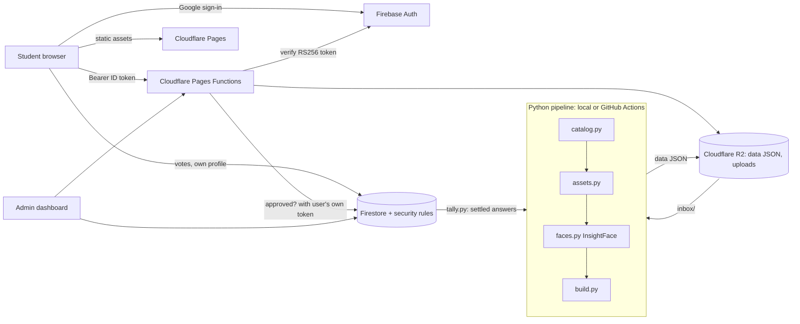

# Smriti: a crowd-curated school photo archive

> Hundreds of school photos, one batch of students, zero hosting bill.
> Face matching proposes who is in each photo. The students themselves confirm it. A free-tier stack keeps it private and costs nothing to run.

Smriti (Sanskrit for *memory*) turns a messy folder of event photos into a private gallery where every student can find their own pictures, browse friend groups, and help the archive learn who is who and where each photo was taken.

It was built for a real client (a school) by two freelancers on a hard constraint: **no paid services**.

**Status:** all parts are implemented and covered by automated tests (rules, Functions, tally). The first live deployment and browser end-to-end tests are still to come, so treat this as a serious prototype, not a finished product.

## What it does

- **Private gallery.** Photos, people, places and a force-directed "friends" graph built from who appears together.
- **Face matching, humans in the loop.** InsightFace embeds every face and proposes candidates. Anything uncertain becomes a review question instead of a guess.
- **Crowd review.** Students answer short questions ("Is this Asha?", "Where was this taken?"). A weighted vote settles each one. Disputes go to an admin.
- **Google sign-in, locked to the batch.** Only accounts shaped like `rkmv<registration number>@gmail.com` that are in the roster *and* approved by an admin get in.
- **Student uploads** with server-side validation, quotas and admin approval.
- **Admin dashboard.** Approve students, resolve disputes, review uploads, watch per-student stats, export the settled answers.
- **Safe ingest** of the school's own Facebook page photos with `gallery-dl`, on the school's permission, run locally with your own cookies.
- **Accessible, no-build front end.** Vanilla ES modules, keyboard-first review UI, works at phone width.

## Architecture



Design notes live in [`docs/ARCHITECTURE.md`](docs/ARCHITECTURE.md). The build contract the parts were written against is [`gallery/CONTRACT.md`](gallery/CONTRACT.md).

## How the crowd decides

Every review question gets one vote per student. Votes are weighted and tallied by [`gallery/pipeline/tally.py`](gallery/pipeline/tally.py):

| Rule | Value |
|---|---|
| Normal vote | weight 1 |
| "That's me" from a student who is one of the candidates | weight 2 |
| **Settled** | top answer weight >= 3 **and** >= 2x the runner-up |
| **Disputed** | total weight >= 5 and not settled, goes to the admin |
| Admin override | always wins |
| `skip` | ignored |

A cluster answer ("these 14 faces are the same person") settles every face in the cluster at once, so the biggest questions are shown first.

## Security model

Photos of minors and face data are the sensitive part, so the rules are strict and tested.

| Threat | Control |
|---|---|
| Someone outside the batch signs in | Firestore rules and the Function both require `email_verified`, the `rkmv<digits>@gmail.com` pattern, and a roster entry |
| A student approves themselves | `users` create is forced to `pending`; only an admin can change `status` (tested) |
| Vote tampering or ballot stuffing | One doc per `{question}__{uid}`; rules force own uid, approved status, valid id format and a matching question type (tested) |
| Quota exhaustion by one account | Id format and length limits, 50 pending uploads per student, 10 MB streamed upload cap |
| Forged tokens | Functions verify Firebase ID tokens with WebCrypto against Google's JWKS: algorithm pinned to RS256, `aud`, `iss`, `exp`, `sub` and `email_verified` checked |
| Student names served publicly | Data JSON lives in R2 and is only served by an authenticated Function, never as a static file |
| Private data in git | `.gitignore` excludes photos, `data/`, embeddings and secrets; the admin list is a Pages secret |

**Known limits, stated plainly:**

- Photos are served as static assets so they cost nothing. They are protected by unguessable filenames (capability links), not by a login check, because the free Workers tier allows only 100k requests a day. Anyone who obtains one photo's link can open that photo. Per-image auth means paying for Workers or other hosting.
- Firestore security rules cannot rate-limit. Abuse is bounded by the quotas above and visible in the admin Stats tab.
- Student emails follow a guessable pattern, so the admin approval step is not optional.

See [`SECURITY.md`](SECURITY.md) for the reporting policy.

## Free-tier budget

| Service | Used for | Free limit |
|---|---|---|
| Firebase Auth | Google sign-in | 50k monthly active users |
| Firestore | votes, users, progress | 50k reads and 20k writes per day, 1 GiB |
| Cloudflare Pages | site + Functions | unlimited static bandwidth, 100k Function requests per day |
| Cloudflare R2 | data JSON, uploads | 10 GB |
| GitHub Actions | face scan (private repo) | 2000 minutes per month |

Read budget is the tight one, so a student's browser reads one progress doc plus only their own votes, with the answered set cached locally. The question list is a static JSON.

## Tech stack

Vanilla JavaScript (ES modules, no bundler) | Firebase Auth and Firestore | Cloudflare Pages, Functions and R2 | Python 3.12, InsightFace, ONNX Runtime, NetworkX, d3 | Node test runner and the Firebase emulator | GitHub Actions

## Repo map

```
gallery/
  index.html, css/, js/        front end (review UI, friends graph, admin, upload)
  js/auth.js, votes.js         Firebase sign-in and vote helpers
  js/admin-data.js             admin-only Firestore helpers
  firestore.rules              security rules (the real access-control layer)
  functions/                   Cloudflare Pages Functions (token check, data, uploads)
  pipeline/                    catalog, assets, faces, build, tally, roster seeding, ingest, deploy
  tests/                       rules tests (Firebase emulator)
.github/workflows/scan.yml     scheduled face scan
docs/ARCHITECTURE.md           how and why
```

## Getting started

**Prerequisites:** Node 20+, Python 3.12, and a JDK 17+ *only* for the Firestore emulator (the emulator is a Java program; nothing else here needs Java).

```bash
# 1. Rules tests (emulator)
cd gallery/tests && npm install && npm test          # 7 tests

# 2. Function tests
cd gallery/functions && node --test --test-isolation=none tests/*.test.mjs   # 6 tests

# 3. Tally tests
cd gallery/pipeline && python -m unittest test_tally  # 3 tests
```

**Deploy (all free):**

1. Create a Firebase project, enable Google sign-in and Firestore, paste the web config into `gallery/js/firebase-config.js`, then `firebase deploy --only firestore:rules`.
2. Create an R2 bucket, put its name in `gallery/wrangler.toml`.
3. `npx wrangler pages secret put ADMIN_EMAILS` (comma-separated admin emails).
4. Seed the roster: `python gallery/pipeline/seed_roster.py --dry-run` first.
5. `gallery/pipeline/deploy_cloudflare.ps1 -Deploy -Bucket <bucket>` (builds `dist/`, uploads data to R2, deploys Pages).

The photo data, face embeddings and student list are **never** in this repository. You bring your own.

## Privacy and ethics

This project handles photos and biometric data of minors. If you adapt it: get written consent from the institution and guardians, follow your local law (for example India's DPDP Act), keep the repository private or data-free, and never publish the roster. Face recognition here only *proposes*; people decide.

## Roadmap

- Unguessable image filenames at build time (`HMAC(id)`), then optional per-image auth
- Finish the CI scan end to end (portrait source on the runner, image upload, inbox archive)
- Instagram ingest alongside Facebook
- Browser smoke tests for the sign-in and review flows

## About the author

Built by **Padmashree Jha** ([codewithpom@gmail.com](mailto:codewithpom@gmail.com)). Full-stack and applied-ML work under tight budgets: security rules, auth, free-tier systems design, computer-vision pipelines, accessible front ends. Open to roles and freelance work.
