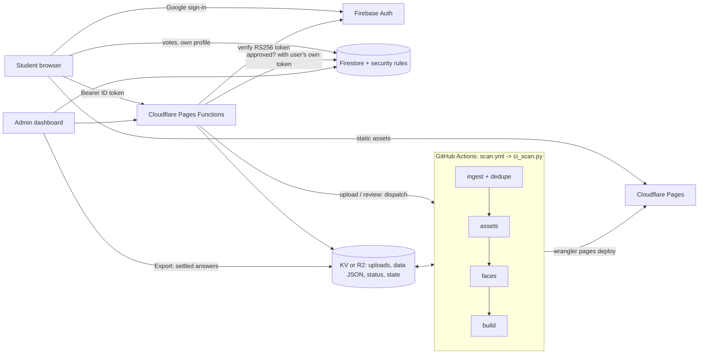

# Smriti

**A private photo archive for a school batch, where face matching proposes and the students confirm. Runs entirely on free tiers.**

[](https://github.com/codewithpom/smriti/actions/workflows/ci.yml)
[](LICENSE)
[](https://smriti-gallery.pages.dev)

**[Live demo](https://smriti-gallery.pages.dev)** (fabricated data, no sign-in, press **F** in the photo viewer to outline faces)


## Why this exists

I'm an ex-student of a school that runs under a charity trust. A few hundred photos of my batch were scattered across phones and the school's Facebook page, and nobody knew who was in what. I'm building Smriti (Sanskrit for *memory*) for them, unpaid, so every classmate can find their own pictures.

The hard parts turned out to be the interesting ones: the photos show minors, there is no hosting budget, and a face matcher is wrong often enough that I didn't want it deciding on its own. So the model only **proposes**, and the students **confirm**.

If that sounds like something you'd like to help with, you're very welcome. See [Contributing](#contributing) and the [good first issues](https://github.com/codewithpom/smriti/labels/good%20first%20issue).

## Features

- **Private gallery.** Photos, people, places and a force-directed "friends" graph built from who appears together.
- **Face matching, humans in the loop.** The recipe photo apps like Immich use, tuned for a CPU runner: SCRFD detection, ArcFace embeddings with flip test-time augmentation, a per-face quality score (sharpness, pose, size, detector confidence), quality-weighted person prototypes, and HDBSCAN clustering of unknown faces with a cannot-link rule (one person appears once per photo). AdaFace fusion is optional, and `eval_match.py --clusters` gates any change. Anything uncertain becomes a review question instead of a guess.
- **Automatic ingest on GitHub Actions.** An upload triggers the `scan` workflow, which only processes new photos. Each upload shows its progress live: queued, processing (stage x of y), waiting for approval, live.
- **Duplicate detection.** Each photo gets a perceptual hash (DCT pHash), computed identically in the browser and the pipeline. The upload page warns about photos already in the archive before anything is sent, and the pipeline drops duplicates. Existing duplicates in the archive are hidden without being deleted.
- **Storage switch.** Workers KV (free, no card, 1 GB) or R2 (free up to 10 GB, card on file), chosen with a radio button in Admin > Ingest. "Copy data now" migrates every key and verifies it.
- **Crowd review.** Students answer short questions ("Is this Asha?", "Where was this taken?"). A weighted vote settles each one and disputes go to an admin.
- **Google sign-in, locked to the batch.** Only verified `rkmv<registration number>@gmail.com` accounts that are on the roster get in. An admin can add emails and block accounts. An admin can also switch on approval mode, so each new student waits to be approved.
- **Student uploads** with server-side validation and per-student quotas. Photos are processed straight away and published after admin approval.
- **Admin dashboard.** Manage users, resolve disputes, review uploads, watch per-student stats, export settled answers.
- **Unnamed people, named later.** Faces that match nobody are grouped automatically into stable unnamed people (the same group keeps its id between scans). Name a group once in Review and every face in it is labelled, like Google Photos and Immich.
- **Facebook page ingest** with `gallery-dl`, on the page owner's permission. Run it locally, or opt in from the admin panel's Ingest tab: cookies are saved write-only in the private R2 bucket and the `scan` workflow reads them on the runner (never in the repo, never in logs, deleted after the run). Facebook can lock a session used from a datacenter IP, so use a throwaway account.
- **Home feed and landing page.** Signed-out visitors see a drawn landing page, never a real photo. Members get a Home feed that reshuffles every visit, with the dated grid under All photos.
- **No build step.** Vanilla ES modules, keyboard-first review UI, works at phone width.


## Try it

**Online:** <https://smriti-gallery.pages.dev>. Everything there is fabricated.

**Locally** (browse only, no accounts):

```bash
git clone https://github.com/codewithpom/smriti && cd smriti
cp -r gallery/demo/data gallery/demo/img gallery/      # git-ignored folders; this overwrites any data you keep there
python -m http.server 8000 --directory gallery --bind 127.0.0.1
# open http://127.0.0.1:8000
```

On `127.0.0.1` the app skips sign-in and reads the static files. Review answers aren't saved in this mode.

## How it works



Design notes and the reasoning behind each choice: [`docs/ARCHITECTURE.md`](docs/ARCHITECTURE.md). The build contract the parts were written against: [`gallery/CONTRACT.md`](gallery/CONTRACT.md).

### How the crowd decides

One vote per student per question, tallied by [`gallery/pipeline/tally.py`](gallery/pipeline/tally.py):

| Rule | Value |
|---|---|
| Normal vote | weight 1 |
| "That's me" from a student who is one of the candidates | weight 2 |
| **Settled** | top answer weight >= 3 **and** >= 2x the runner-up |
| **Disputed** | total weight >= 5 and not settled, goes to the admin |
| Admin override | always wins |
| `skip` | ignored |

A cluster answer ("these 14 faces are the same person") settles every face in the cluster at once, so clusters are asked first.

## Project layout

```
gallery/
  index.html, css/, js/        front end (review UI, friends graph, admin, upload)
  firestore.rules              security rules: the real access-control layer
  functions/                   Cloudflare Pages Functions (token check, data, uploads)
  pipeline/                    catalog, assets, faces, build, tally, roster seeding, ingest, deploy
  demo/                        fabricated demo dataset and the script that builds it
  tests/                       Firestore rules tests (emulator)
docs/                          architecture notes and screenshots
.github/                       CI, issue and PR templates
```

## Development

**Prerequisites:** Node 20+, Python 3.12, and a JDK 17+ *only* for the Firestore emulator.

```bash
# Firestore rules (emulator)
cd gallery/tests && npm install && npm test

# Cloudflare Functions
cd gallery/functions && node --test --test-isolation=none tests/*.test.mjs

# Pipeline: every unit test (faces, dedupe, storage, incremental scan, ...)
cd gallery/pipeline && python -m unittest discover -p "test_*.py"

# Demo dataset consistency
pip install pillow && python gallery/demo/check_demo.py

# Whole ingest pipeline with real InsightFace on the synthetic demo faces (uploads, duplicates, approval, publish)
pip install -r gallery/pipeline/requirements-scan.txt && python -I gallery/demo/e2e_scan.py
```

The face pipeline needs `insightface`, `onnxruntime`, `numpy`, `scipy` and `pillow` (see [`gallery/pipeline/requirements-scan.txt`](gallery/pipeline/requirements-scan.txt)). Paths come from `RKMV_SOURCE` (photos, one folder per album) and `RKMV_PEOPLE` (student portraits and `identities.json`).

## Deploy your own (all free)

1. Create a Firebase project, enable Google sign-in and Firestore, paste the web config into `gallery/js/firebase-config.js`, then `firebase deploy --only firestore:rules`.
2. Create a free KV namespace (`wrangler kv namespace create <name>`, no card needed) and copy `gallery/deploy/smriti.toml` to your own target with that id.
3. `npx wrangler pages secret put ADMIN_EMAILS` (comma-separated admin emails; also edit the admin list in `firestore.rules`).
4. Import the roster from the admin dashboard, or with `python gallery/pipeline/seed_roster.py --dry-run` first.
5. Choose the approval mode in Admin > Users: `auto` (default) approves a roster student on first sign-in, `admin` leaves new users pending until you approve them.
6. `gallery/pipeline/deploy_cloudflare.ps1 -Target <yours> -Deploy` builds `dist/`, renames images to unguessable names, uploads the data JSON to KV and deploys Pages.

### Automatic ingest (GitHub Actions)

After the first deploy, the `scan` workflow takes over processing and publishing for the real site. The default branch schedules and forwards scans; the pipeline runs from the `automation/scan` branch. Manual dispatches from the default branch are forwarded there with their selected options. The workflow never uses the repo's `wrangler.toml`, which binds the demo. It writes its own, binding `PHOTOS` to the chosen storage. The workflow's default `GITHUB_TOKEN` needs Actions write permission to dispatch the scan branch.

1. **GitHub variables:** `STORAGE_BACKEND` (`kv` or `r2`), `PAGES_PROJECT`, `FIREBASE_PROJECT_ID`.
2. **GitHub secrets:** `CLOUDFLARE_ACCOUNT_ID`, `CLOUDFLARE_API_TOKEN` (Pages: Edit, plus Workers KV: Edit for kv mode), `IMG_KEY` (the content of `gallery/pipeline/.secrets/img-key.txt`, so image names stay stable). For kv mode add `CF_KV_NAMESPACE_ID`. For r2 mode add `R2_BUCKET`, `R2_ACCESS_KEY_ID` and `R2_SECRET_ACCESS_KEY`.
3. **Pages secret** `GITHUB_DISPATCH_TOKEN`: a fine-grained token for this repo only, with Actions read/write and Variables read/write. It lets uploads start the workflow on `automation/scan` and lets the storage radio set `STORAGE_BACKEND`.
4. **Seed once from your machine.** Run `python gallery/pipeline/ci_scan.py --backfill-hashes <albums dir>` (adds the hashes and marks existing duplicates). Then run `obfuscate.py --src gallery --out <dir>` and `python gallery/pipeline/remote.py seed --data gallery/data --site <dir> --people <people dir>` (`--site` is the obfuscate output, so the served JSON and the stored images use the same renamed paths), adding `--originals <albums dir>` on R2. The seed respects the KV daily write budget, so rerun it the next day if it stops early.

A run costs nothing when nothing is pending (the daily cron exits in seconds). Uploads in a burst share one queued run.

Seed the complete private catalog before enabling ingest on an existing gallery. The scanner refuses to rebuild if any published photo is absent from the stored catalog, preserving the live archive and queued uploads until seeding is complete. The served JSON alone cannot replace the original pipeline state and face embeddings.

### Recovery backups

The `Recover archive` workflow runs only on `automation/scan`. It decrypts recovery inputs on the runner, rebuilds embeddings, preserves historical photo IDs and face labels, verifies the rebuilt gallery, and seeds private storage. It encrypts the rebuilt state before committing a backup to that branch. No plaintext photos, names, embeddings, image keys, or cookies are committed or uploaded as Actions artifacts. Published data switches only after its static images deploy successfully.

Public backup directories contain AES-256-GCM ciphertext chunks and cryptographic metadata. `RECOVERY_BACKUP_PASSWORD` is a separate GitHub Actions secret; keep an independent copy in a password manager because GitHub secrets cannot be read back. `IMG_KEY` is the regenerated image-name key. Losing the old key requires new URLs; recovery retains the deployed image URLs as aliases. Tiny historical faces that cannot be detected again retain their labels and positions with an explicit missing-embedding marker; they never become recognition references.

After `Recover archive` completes and commits `backups/recovery`, run **Finalize recovered image baseline** from Actions with `automation/scan` selected, before the first normal scan. It regenerates only canonical avatars, uploads changed avatar files under their existing opaque image paths, writes their SHA-1 manifest after verifying the uploaded bytes, republishes static assets, then activates the recovered JSON. It does not rerun embeddings or replace the packed baseline. Retries compare remote avatar bytes and skip successful uploads. This one-time workflow allows up to 900 KV writes (the documented free limit is about 1,000); ordinary scans retain the 700-write cap.

To restore an encrypted snapshot locally, install `cryptography==48.0.0`, supply `RECOVERY_BACKUP_PASSWORD` through the environment, and run `python gallery/pipeline/encrypted_backup.py unpack backups/recovery <private-empty-directory>`. Keep the result outside tracked paths. The encrypted bootstrap includes deployed web-sized photos; it does not recreate deleted full-resolution originals. Private KV uses packed image and portrait baselines to avoid thousands of initial writes, and later scans upload only new files.

The `rkmv<number>@gmail.com` email pattern belongs to the school this was built for. Change it in `firestore.rules`, `gallery/js/auth.js` and `gallery/functions/_shared/auth.js` for your own deployment.

### Free-tier budget

| Service | Used for | Free limit |
|---|---|---|
| Firebase Auth | Google sign-in | 50k monthly active users |
| Firestore | votes, users, progress | 50k reads and 20k writes per day, 1 GiB |
| Cloudflare Pages | site + Functions | unlimited static bandwidth, 100k Function requests per day |
| Cloudflare Workers KV | uploads, data JSON, status, pipeline state, images | 1 GB, about 1k writes per day (no card needed). The pipeline keeps itself under 700 a day |
| Cloudflare R2 (optional) | the same, plus original photos | 10 GB, 1M writes and 10M reads a month, no egress fees (card on file) |
| GitHub Actions | face recognition, duplicates, publishing | free for public repos |

Read budget is the tight one, so a student's browser reads one progress doc plus only their own votes, with the answered set cached locally.

## Security and privacy

Photos of minors and face data are the sensitive part, so the rules are strict and tested. See [`SECURITY.md`](SECURITY.md) for how to report a problem.

| Threat | Control |
|---|---|
| Someone outside the batch signs in | Firestore rules and the Function both require `email_verified`, the email pattern, and a roster entry |
| A student unblocks or promotes themselves | `users` can only be created for a roster member through Google sign-in, with a server timestamp; only an admin can change `status` (tested) |
| Students admitted without review | Approval mode in `meta/config`: `auto` (default) approves a roster student on first sign-in; `admin` keeps new users `pending` until an admin approves them (tested) |
| Vote tampering or ballot stuffing | One doc per `{question}__{uid}`; rules force own uid, approved status, an exact payload shape, answer format and a matching question type. An update must wait 10 seconds after the stored vote, which caps update loops (tested) |
| Junk entries in extra people | `people_extra` can only be added for a registration number that is in the roster, so the collection stays roster-sized (every student reads it). New entries stay `pending` until an admin approves them, and only the creator and admins can read pending entries (tested) |
| Quota exhaustion by one account | Id format and length limits, 50 pending uploads per student, 10 MB streamed upload cap |
| Forged tokens | Functions verify Firebase ID tokens with WebCrypto against Google's keys: RS256 pinned, `aud`, `iss`, `exp`, `sub` and `email_verified` checked |
| Student names served publicly | Data JSON lives in KV and is served only by an authenticated Function, never as a static file |
| Private data in git | `.gitignore` excludes photos, `data/`, embeddings and secrets; the admin list is a Pages secret |

**Known limits, stated plainly:**

- Photos are static assets protected by unguessable filenames (capability links), not by a login check, because the free Workers tier allows only 100k requests a day. Anyone who obtains one photo's link can open that photo. Ideas for better: see the open issues.
- Firestore rules cannot rate-limit. Abuse is bounded by the quotas above and visible in the admin Stats tab.
- The vote update throttle does not stop a delete-then-create loop, because rules have no per-user counter.
- Vote question ids are only format-checked, not checked against the question list, so junk ids cost writes. The tally ignores them.
- In `auto` approval mode, anyone who creates a roster Gmail address nobody has claimed can sign in. Use `admin` mode if the school did not create the addresses.
- Student emails follow a guessable pattern, so the roster and the verified-email check are the only gate. Add an address to the roster only if you know it belongs to that student.
- This handles photos and biometric data of minors. If you adapt it, get written consent from the institution and guardians, follow your local law (for example India's DPDP Act), and never publish the roster or the photos.

## Contributing

Contributions are welcome, from typo fixes to the roadmap items below. Read [`CONTRIBUTING.md`](CONTRIBUTING.md) first; the short version:

1. Pick an issue, especially one labelled [good first issue](https://github.com/codewithpom/smriti/labels/good%20first%20issue), and say you're on it.
2. Keep it small, add or update a test, and run the checks in [Development](#development).
3. **Never commit real photos, names, registration numbers, face data or cookies.** Use the demo dataset.

By taking part you agree to the [Code of Conduct](CODE_OF_CONDUCT.md).

### Roadmap

Tracked as [issues](https://github.com/codewithpom/smriti/issues). Highlights: browser smoke tests, per-image access control, a finished scheduled face-scan job, Instagram ingest, translated UI strings, an accessibility audit.

## License and credits

- Code: [MIT](LICENSE).
- Demo faces: samples from the [SFHQ synthetic face set](https://www.kaggle.com/datasets/selfishgene/synthetic-faces-high-quality-sfhq-part-1) (StyleGAN2, CC0-1.0 on Kaggle). They depict nobody. Details in [`gallery/demo/README.md`](gallery/demo/README.md).
- Face matching uses [InsightFace](https://github.com/deepinsight/insightface). Its pretrained models are published for non-commercial research use, which fits a volunteer project for a charity school but may not fit yours. Check their terms before you deploy.
- Built on Firebase, Cloudflare Pages and Workers, `gallery-dl`, NetworkX and d3.

## Author

Built by **Padmashree Jha** ([codewithpom@gmail.com](mailto:codewithpom@gmail.com)), an ex-student giving something back. I like systems design under tight budgets: security rules, auth, free-tier architecture, computer-vision pipelines, accessible front ends. Open to full-stack and applied-ML roles.
